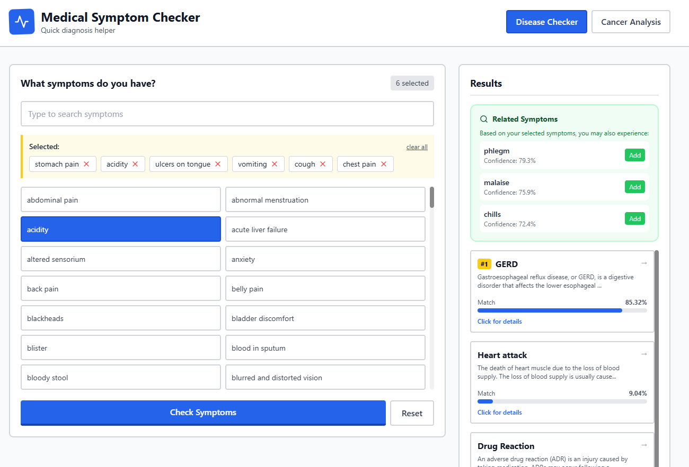

# How to run this app?

1. **Install Dependencies**: Make sure you have Node.js installed. 

2. **Clone the Repository**: Clone this repository to your local machine.

3. **Navigate to the Project Directory**: Open your terminal and navigate to the project directory.

4. **Install Required Packages**: Use 'pip install -r requirements.txt' to install the necessary Python packages.

5. **Windows:**
    ```cmd
    setup.bat
    start.bat
    ```

    **Linux/Mac:**
    ```bash
    chmod +x setup.sh start.sh
    ./setup.sh
    ./start.sh
    ```
6. **Access the App**: Go to the frontend directory and run 'npm start' to launch the React app. 
    ```
    cd ./frontend

    npm install
    npm start
    ```
 

